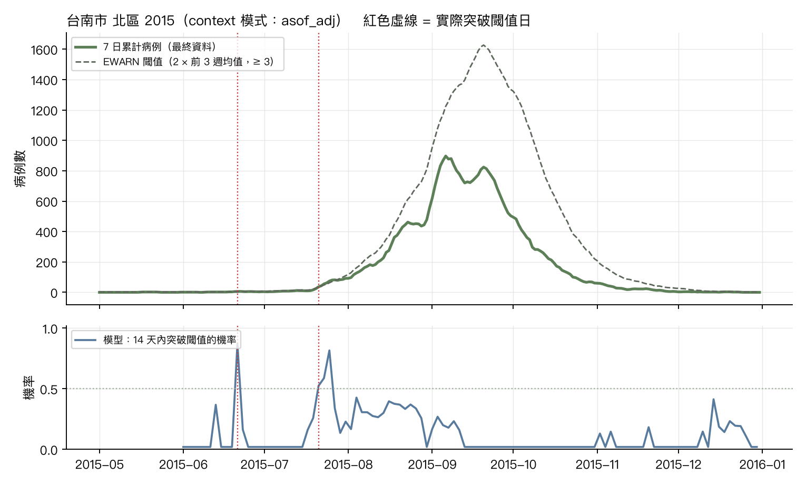
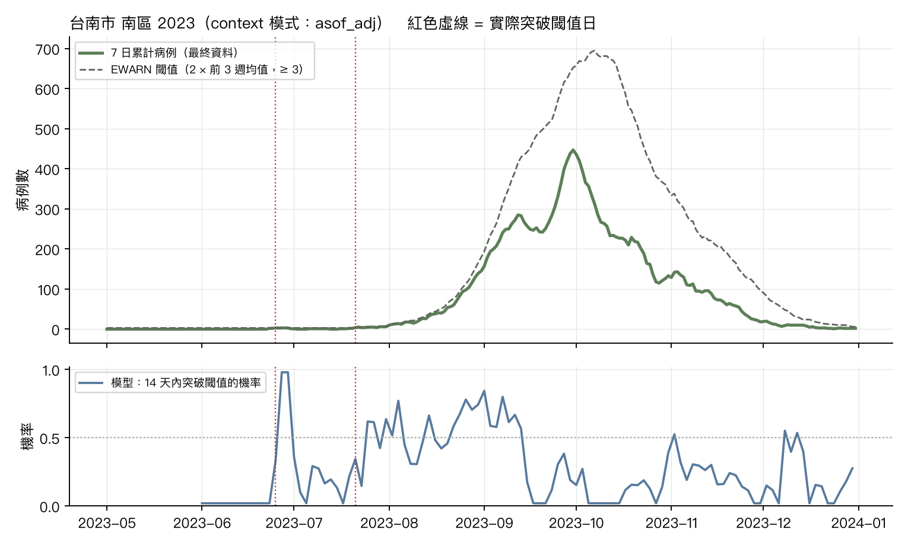

# 登革熱鄉鎮每日回測：閾值突破預警（CHG 情境一，第一版）

資料：登革熱每日確定病例（本土，居住鄉鎮），台南 37 區 + 高雄 38 區中 2012 起有病例的 74 區；目標 = 7 日累計病例；閾值 = max(2 × 前 3 週週均值, 3 例)（EWARN 規則加下限）。
起點：2015, 2023 年 6–12 月每 2 天；horizon 1–14 天；context 2 年（730 天）。模式：final = 以最終資料為 context（無通報延遲）、asof = 只用起點當日已通報者、asof_adj = as-of 除以歷史通報完整度。
事件（真值）= 最終資料的 7 日累計 ≥ 以最終資料計算的起點當日 EWARN 閾值，三種模式共用同一組事件；警示機率則用各模式在起點當日可得資料算出的閾值。面板自 2008-01-01 起；流行年 = 2015、2023（該年本土病例 ≥ 1,000）。

## 1. 7 日累計的分布預測表現（WIS 越低越好；cov80 理想 0.80）

|                               |   WIS h=1 |   WIS h=3 |   WIS h=5 |   WIS h=7 |   WIS h=10 |   WIS h=14 |   cov80 h=7 |   cov80 h=14 |
|:------------------------------|----------:|----------:|----------:|----------:|-----------:|-----------:|------------:|-------------:|
| ('asof_adj', 'kde_fix')       |      5.86 |      6.44 |      7.27 |      8.33 |      10.28 |      13.74 |        0.8  |         0.79 |
| ('asof_adj', 'kde_mix')       |      4.13 |      4.86 |      5.87 |      7.1  |       9.21 |      12.89 |        0.85 |         0.8  |
| ('asof_adj', 'kde_rv')        |      5.82 |      6.45 |      7.34 |      8.46 |      10.49 |      14.09 |        0.78 |         0.76 |
| ('asof_adj', 'kde_rv_season') |      5.94 |      6.52 |      7.37 |      8.45 |      10.41 |      13.95 |        0.78 |         0.76 |
| ('asof_adj', 'naive')         |      4.22 |      5.08 |      6.18 |      7.25 |       8.6  |      10.26 |        0.53 |         0.52 |
| ('asof_adj', 'snaive')        |     12.07 |     12.16 |     12.25 |     12.33 |      12.42 |      12.55 |        0.69 |         0.68 |
| ('asof_adj', 'tfm')           |      3.72 |      4.21 |      4.97 |      5.79 |       6.94 |       8.55 |        0.75 |         0.73 |
| ('final', 'kde_fix')          |      5.26 |      5.45 |      5.79 |      6.25 |       7.03 |       8.28 |        0.78 |         0.77 |
| ('final', 'kde_mix')          |      3.45 |      3.77 |      4.26 |      4.88 |       5.8  |       7.25 |        0.86 |         0.82 |
| ('final', 'kde_rv')           |      5.2  |      5.45 |      5.85 |      6.36 |       7.22 |       8.63 |        0.76 |         0.75 |
| ('final', 'kde_rv_season')    |      5.39 |      5.6  |      5.95 |      6.43 |       7.26 |       8.64 |        0.76 |         0.74 |
| ('final', 'naive')            |      0.99 |      2.44 |      3.75 |      4.91 |       6.23 |       7.91 |        0.56 |         0.54 |
| ('final', 'snaive')           |     12.07 |     12.16 |     12.24 |     12.32 |      12.42 |      12.55 |        0.69 |         0.68 |
| ('final', 'tfm')              |      0.69 |      1.63 |      2.63 |      3.66 |       4.82 |       6.28 |        0.77 |         0.75 |

h = 7 的 WIS 依年份類型（流行年 = 2015、2023）：

|                               |   流行年 |
|:------------------------------|------:|
| ('asof_adj', 'kde_fix')       |  8.33 |
| ('asof_adj', 'kde_mix')       |  7.1  |
| ('asof_adj', 'kde_rv')        |  8.46 |
| ('asof_adj', 'kde_rv_season') |  8.45 |
| ('asof_adj', 'naive')         |  7.25 |
| ('asof_adj', 'snaive')        | 12.33 |
| ('asof_adj', 'tfm')           |  5.79 |
| ('final', 'kde_fix')          |  6.25 |
| ('final', 'kde_mix')          |  4.88 |
| ('final', 'kde_rv')           |  6.36 |
| ('final', 'kde_rv_season')    |  6.43 |
| ('final', 'naive')            |  4.91 |
| ('final', 'snaive')           | 12.32 |
| ('final', 'tfm')              |  3.66 |

## 2. 閾值突破預警：機率技巧與 p* 取捨

事件 = 未來 14 天內 7 日累計 ≥ 起點當日以最終資料計算的閾值（三種模式相同）；模型機率 = 各 horizon 機率的最大值（機率的閾值為該模式當日可得資料所算）。假警報率以「鄉鎮 × 週」計：該週任一起點發警示即算一次警示週，該週任一起點有事件即算事件週。

AUC（鄉鎮週層級，事件 vs 模型機率）：

| mode     |   kde_fix |   kde_mix |   kde_rv |   kde_rv_season |   naive |   snaive |   tfm |
|:---------|----------:|----------:|---------:|----------------:|--------:|---------:|------:|
| asof_adj |     0.836 |     0.875 |    0.814 |           0.816 |    0.8  |    0.754 | 0.851 |
| final    |     0.837 |     0.893 |    0.815 |           0.815 |    0.77 |    0.754 | 0.881 |

TimesFM（final）p* 掃描（4,588 鄉鎮週，其中事件週 946）：

|   p_star |   sensitivity |   false_alarm_per100 |   ppv |   alerts |
|---------:|--------------:|---------------------:|------:|---------:|
|      0.2 |         0.733 |               18.342 | 0.509 |     1361 |
|      0.3 |         0.606 |                9.83  | 0.615 |      931 |
|      0.4 |         0.518 |                5.299 | 0.717 |      683 |
|      0.5 |         0.42  |                3.13  | 0.777 |      511 |
|      0.6 |         0.333 |                1.785 | 0.829 |      380 |
|      0.7 |         0.222 |                0.549 | 0.913 |      230 |
|      0.8 |         0.132 |                0.22  | 0.94  |      133 |
|      0.9 |         0.068 |                0.082 | 0.955 |       67 |

kde_fix（final）p* 掃描（4,588 鄉鎮週，其中事件週 946）：

|   p_star |   sensitivity |   false_alarm_per100 |   ppv |   alerts |
|---------:|--------------:|---------------------:|------:|---------:|
|      0.2 |         0.444 |                6.864 | 0.627 |      670 |
|      0.3 |         0.427 |                5.437 | 0.671 |      602 |
|      0.4 |         0.375 |                3.844 | 0.717 |      495 |
|      0.5 |         0.331 |                2.691 | 0.762 |      411 |
|      0.6 |         0.277 |                1.73  | 0.806 |      325 |
|      0.7 |         0.24  |                1.098 | 0.85  |      267 |
|      0.8 |         0.188 |                0.659 | 0.881 |      202 |
|      0.9 |         0.108 |                0.137 | 0.953 |      107 |

kde_mix（final）p* 掃描（4,588 鄉鎮週，其中事件週 946）：

|   p_star |   sensitivity |   false_alarm_per100 |   ppv |   alerts |
|---------:|--------------:|---------------------:|------:|---------:|
|      0.2 |         0.555 |                6.507 | 0.689 |      762 |
|      0.3 |         0.52  |                4.97  | 0.731 |      673 |
|      0.4 |         0.436 |                3.048 | 0.788 |      523 |
|      0.5 |         0.39  |                1.785 | 0.85  |      434 |
|      0.6 |         0.337 |                1.126 | 0.886 |      360 |
|      0.7 |         0.259 |                0.714 | 0.904 |      271 |
|      0.8 |         0.173 |                0.22  | 0.953 |      172 |
|      0.9 |         0.045 |                0.027 | 0.977 |       44 |

kde_rv（final）p* 掃描（4,588 鄉鎮週，其中事件週 946）：

|   p_star |   sensitivity |   false_alarm_per100 |   ppv |   alerts |
|---------:|--------------:|---------------------:|------:|---------:|
|      0.2 |         0.39  |                6.425 | 0.612 |      603 |
|      0.3 |         0.367 |                4.942 | 0.658 |      527 |
|      0.4 |         0.326 |                3.24  | 0.723 |      426 |
|      0.5 |         0.276 |                2.279 | 0.759 |      344 |
|      0.6 |         0.236 |                1.51  | 0.802 |      278 |
|      0.7 |         0.186 |                0.769 | 0.863 |      204 |
|      0.8 |         0.138 |                0.412 | 0.897 |      146 |
|      0.9 |         0.066 |                0.082 | 0.954 |       65 |

kde_rv_season（final）p* 掃描（4,588 鄉鎮週，其中事件週 946）：

|   p_star |   sensitivity |   false_alarm_per100 |   ppv |   alerts |
|---------:|--------------:|---------------------:|------:|---------:|
|      0.2 |         0.405 |                7.359 | 0.588 |      651 |
|      0.3 |         0.376 |                6.068 | 0.617 |      577 |
|      0.4 |         0.329 |                4.228 | 0.669 |      465 |
|      0.5 |         0.285 |                3.158 | 0.701 |      385 |
|      0.6 |         0.238 |                2.252 | 0.733 |      307 |
|      0.7 |         0.2   |                1.428 | 0.784 |      241 |
|      0.8 |         0.151 |                0.824 | 0.827 |      173 |
|      0.9 |         0.091 |                0.439 | 0.843 |      102 |

TimesFM（asof_adj）p* 掃描（4,588 鄉鎮週，其中事件週 946）：

|   p_star |   sensitivity |   false_alarm_per100 |   ppv |   alerts |
|---------:|--------------:|---------------------:|------:|---------:|
|      0.2 |         0.693 |               20.593 | 0.467 |     1406 |
|      0.3 |         0.584 |               13.344 | 0.532 |     1038 |
|      0.4 |         0.492 |                7.963 | 0.616 |      755 |
|      0.5 |         0.402 |                4.997 | 0.676 |      562 |
|      0.6 |         0.305 |                3.048 | 0.722 |      400 |
|      0.7 |         0.221 |                2.087 | 0.733 |      285 |
|      0.8 |         0.134 |                0.934 | 0.789 |      161 |
|      0.9 |         0.07  |                0.357 | 0.835 |       79 |

kde_fix（asof_adj）p* 掃描（4,588 鄉鎮週，其中事件週 946）：

|   p_star |   sensitivity |   false_alarm_per100 |   ppv |   alerts |
|---------:|--------------:|---------------------:|------:|---------:|
|      0.2 |         0.481 |                9.885 | 0.558 |      815 |
|      0.3 |         0.447 |                8.155 | 0.588 |      720 |
|      0.4 |         0.401 |                5.958 | 0.636 |      596 |
|      0.5 |         0.353 |                4.558 | 0.668 |      500 |
|      0.6 |         0.304 |                3.377 | 0.701 |      411 |
|      0.7 |         0.263 |                2.197 | 0.757 |      329 |
|      0.8 |         0.209 |                1.181 | 0.822 |      241 |
|      0.9 |         0.123 |                0.329 | 0.906 |      128 |

kde_mix（asof_adj）p* 掃描（4,588 鄉鎮週，其中事件週 946）：

|   p_star |   sensitivity |   false_alarm_per100 |   ppv |   alerts |
|---------:|--------------:|---------------------:|------:|---------:|
|      0.2 |         0.683 |               14.992 | 0.542 |     1192 |
|      0.3 |         0.596 |               11.56  | 0.573 |      985 |
|      0.4 |         0.512 |                7.77  | 0.631 |      767 |
|      0.5 |         0.448 |                5.217 | 0.691 |      614 |
|      0.6 |         0.376 |                3.35  | 0.745 |      478 |
|      0.7 |         0.293 |                1.73  | 0.815 |      340 |
|      0.8 |         0.181 |                0.522 | 0.9   |      190 |
|      0.9 |         0.048 |                0.082 | 0.938 |       48 |

kde_rv（asof_adj）p* 掃描（4,588 鄉鎮週，其中事件週 946）：

|   p_star |   sensitivity |   false_alarm_per100 |   ppv |   alerts |
|---------:|--------------:|---------------------:|------:|---------:|
|      0.2 |         0.404 |                9.171 | 0.534 |      716 |
|      0.3 |         0.372 |                7.496 | 0.563 |      625 |
|      0.4 |         0.328 |                5.437 | 0.61  |      508 |
|      0.5 |         0.294 |                3.789 | 0.668 |      416 |
|      0.6 |         0.261 |                2.938 | 0.698 |      354 |
|      0.7 |         0.205 |                2.032 | 0.724 |      268 |
|      0.8 |         0.15  |                0.961 | 0.802 |      177 |
|      0.9 |         0.074 |                0.247 | 0.886 |       79 |

kde_rv_season（asof_adj）p* 掃描（4,588 鄉鎮週，其中事件週 946）：

|   p_star |   sensitivity |   false_alarm_per100 |   ppv |   alerts |
|---------:|--------------:|---------------------:|------:|---------:|
|      0.2 |         0.44  |               10.187 | 0.529 |      787 |
|      0.3 |         0.412 |                8.375 | 0.561 |      695 |
|      0.4 |         0.354 |                6.178 | 0.598 |      560 |
|      0.5 |         0.314 |                4.585 | 0.64  |      464 |
|      0.6 |         0.271 |                3.432 | 0.672 |      381 |
|      0.7 |         0.22  |                2.306 | 0.712 |      292 |
|      0.8 |         0.171 |                1.318 | 0.771 |      210 |
|      0.9 |         0.109 |                0.494 | 0.851 |      121 |

分層（asof_adj，各預測模型）：區域 × 起點的事件型態。下限群聚 = 起點閾值在 3 例下限（非流行區的第一個群聚）；流行中加速 = 閾值高於下限（流行已在進行）。

| model         | 區域   | 事件型態   |   鄉鎮週 |   事件週 |   AUC |   p_star |   敏感度 |   假警報/100 |   PPV |
|:--------------|:-----|:-------|------:|------:|------:|---------:|------:|----------:|------:|
| tfm           | 台南高雄 | 下限群聚   |  3014 |   325 | 0.778 |      0.3 | 0.302 |     6.285 | 0.367 |
| tfm           | 台南高雄 | 下限群聚   |  3014 |   325 | 0.778 |      0.5 | 0.231 |     3.384 | 0.452 |
| tfm           | 台南高雄 | 流行中加速  |  1574 |   621 | 0.792 |      0.3 | 0.731 |    33.263 | 0.589 |
| tfm           | 台南高雄 | 流行中加速  |  1574 |   621 | 0.792 |      0.5 | 0.491 |     9.549 | 0.77  |
| kde_fix       | 台南高雄 | 下限群聚   |  3014 |   325 | 0.787 |      0.3 | 0.28  |     2.678 | 0.558 |
| kde_fix       | 台南高雄 | 下限群聚   |  3014 |   325 | 0.787 |      0.5 | 0.188 |     1.227 | 0.649 |
| kde_fix       | 台南高雄 | 流行中加速  |  1574 |   621 | 0.794 |      0.3 | 0.535 |    23.61  | 0.596 |
| kde_fix       | 台南高雄 | 流行中加速  |  1574 |   621 | 0.794 |      0.5 | 0.44  |    13.956 | 0.672 |
| kde_mix       | 台南高雄 | 下限群聚   |  3014 |   325 | 0.812 |      0.3 | 0.388 |     5.392 | 0.465 |
| kde_mix       | 台南高雄 | 下限群聚   |  3014 |   325 | 0.812 |      0.5 | 0.231 |     1.673 | 0.625 |
| kde_mix       | 台南高雄 | 流行中加速  |  1574 |   621 | 0.794 |      0.3 | 0.705 |    28.961 | 0.613 |
| kde_mix       | 台南高雄 | 流行中加速  |  1574 |   621 | 0.794 |      0.5 | 0.562 |    15.215 | 0.706 |
| kde_rv        | 台南高雄 | 下限群聚   |  3014 |   325 | 0.749 |      0.3 | 0.132 |     1.413 | 0.531 |
| kde_rv        | 台南高雄 | 下限群聚   |  3014 |   325 | 0.749 |      0.5 | 0.102 |     0.409 | 0.75  |
| kde_rv        | 台南高雄 | 流行中加速  |  1574 |   621 | 0.77  |      0.3 | 0.498 |    24.659 | 0.568 |
| kde_rv        | 台南高雄 | 流行中加速  |  1574 |   621 | 0.77  |      0.5 | 0.395 |    13.326 | 0.659 |
| kde_rv_season | 台南高雄 | 下限群聚   |  3014 |   325 | 0.756 |      0.3 | 0.191 |     2.901 | 0.443 |
| kde_rv_season | 台南高雄 | 下限群聚   |  3014 |   325 | 0.756 |      0.5 | 0.154 |     1.488 | 0.556 |
| kde_rv_season | 台南高雄 | 流行中加速  |  1574 |   621 | 0.781 |      0.3 | 0.528 |    23.82  | 0.591 |
| kde_rv_season | 台南高雄 | 流行中加速  |  1574 |   621 | 0.781 |      0.5 | 0.398 |    13.326 | 0.66  |

## 3. 前置時間：模型預警 vs EWARN 靜態規則、EWMA、CUSUM

事件（episode）= 最終資料的 7 日累計首次達到當日 EWARN 閾值，且之前至少 14 天低於閾值。EWARN 靜態規則在事件當天才觸發（前置 0 天）。模型：事件前 14 天內最早發出警示（機率 ≥ p*）的起點到事件日的天數；EWMA/CUSUM：事件前 14 天內最早的警報日。

事件數（2015, 2023 年 6–12 月）：172，其中流行年 172。

| 方法                            |   偵測到的事件比例 |   前置時間中位數（天） |   前置 ≥ 3 天的比例 |
|:------------------------------|-----------:|-------------:|--------------:|
| EWARN 靜態規則                    |       1    |          0   |          0    |
| EWMA                          |       0.13 |          2   |          0.05 |
| CUSUM                         |       0.55 |          0   |          0.2  |
| TimesFM final p*=0.3          |       0.56 |          6   |          0.42 |
| TimesFM final p*=0.5          |       0.34 |          5   |          0.24 |
| TimesFM final p*=0.7          |       0.13 |          2   |          0.06 |
| kde_fix final p*=0.3          |       0.42 |         13   |          0.4  |
| kde_fix final p*=0.5          |       0.32 |         13   |          0.29 |
| kde_fix final p*=0.7          |       0.22 |         13   |          0.22 |
| kde_mix final p*=0.3          |       0.57 |         10   |          0.42 |
| kde_mix final p*=0.5          |       0.36 |          8.5 |          0.27 |
| kde_mix final p*=0.7          |       0.19 |          8.5 |          0.16 |
| kde_rv final p*=0.3           |       0.29 |         13   |          0.28 |
| kde_rv final p*=0.5           |       0.24 |         13   |          0.21 |
| kde_rv final p*=0.7           |       0.17 |         11   |          0.14 |
| kde_rv_season final p*=0.3    |       0.31 |         13   |          0.3  |
| kde_rv_season final p*=0.5    |       0.24 |         13   |          0.2  |
| kde_rv_season final p*=0.7    |       0.16 |         13   |          0.13 |
| TimesFM asof_adj p*=0.3       |       0.53 |          7   |          0.39 |
| TimesFM asof_adj p*=0.5       |       0.37 |          4.5 |          0.26 |
| TimesFM asof_adj p*=0.7       |       0.19 |          3   |          0.13 |
| kde_fix asof_adj p*=0.3       |       0.43 |         13   |          0.39 |
| kde_fix asof_adj p*=0.5       |       0.32 |         13   |          0.28 |
| kde_fix asof_adj p*=0.7       |       0.24 |         13   |          0.2  |
| kde_mix asof_adj p*=0.3       |       0.65 |          9.5 |          0.51 |
| kde_mix asof_adj p*=0.5       |       0.4  |          9   |          0.28 |
| kde_mix asof_adj p*=0.7       |       0.23 |          8.5 |          0.17 |
| kde_rv asof_adj p*=0.3        |       0.28 |         13   |          0.24 |
| kde_rv asof_adj p*=0.5        |       0.23 |         13   |          0.19 |
| kde_rv asof_adj p*=0.7        |       0.16 |         11   |          0.13 |
| kde_rv_season asof_adj p*=0.3 |       0.32 |         13   |          0.29 |
| kde_rv_season asof_adj p*=0.5 |       0.23 |         13   |          0.21 |
| kde_rv_season asof_adj p*=0.7 |       0.16 |         13   |          0.16 |

統計偵測器在非事件期間（事件前後 14 天以外）的假警報：

| 方法    |   非事件鄉鎮週數 |   假警報週 |   每 100 鄉鎮週假警報 |
|:------|----------:|-------:|---------------:|
| EWMA  |      4026 |    154 |           3.83 |
| CUSUM |      4026 |    416 |          10.33 |

配對比較：在不高於各偵測器假警報率的 p* 下，模型的敏感度與前置時間：

| 對照偵測器   |   其假警報/100 鄉鎮週 | 模式       | 模型            |   模型 p* |   模型假警報/100 |   模型敏感度（週） |   模型偵測事件比例 |   模型前置中位數（天） |
|:--------|---------------:|:---------|:--------------|--------:|------------:|-----------:|-----------:|-------------:|
| EWMA    |           3.83 | final    | TimesFM       |     0.5 |        3.13 |      0.42  |       0.34 |            5 |
| EWMA    |           3.83 | final    | kde_fix       |     0.5 |        2.69 |      0.331 |       0.32 |           13 |
| EWMA    |           3.83 | final    | kde_mix       |     0.4 |        3.05 |      0.436 |       0.41 |           10 |
| EWMA    |           3.83 | final    | kde_rv        |     0.4 |        3.24 |      0.326 |       0.27 |           13 |
| EWMA    |           3.83 | final    | kde_rv_season |     0.5 |        3.16 |      0.285 |       0.24 |           13 |
| EWMA    |           3.83 | asof_adj | TimesFM       |     0.6 |        3.05 |      0.305 |       0.3  |            3 |
| EWMA    |           3.83 | asof_adj | kde_fix       |     0.6 |        3.38 |      0.304 |       0.27 |           13 |
| EWMA    |           3.83 | asof_adj | kde_mix       |     0.6 |        3.35 |      0.376 |       0.33 |            8 |
| EWMA    |           3.83 | asof_adj | kde_rv        |     0.5 |        3.79 |      0.294 |       0.23 |           13 |
| EWMA    |           3.83 | asof_adj | kde_rv_season |     0.6 |        3.43 |      0.271 |       0.18 |           13 |
| CUSUM   |          10.33 | final    | TimesFM       |     0.3 |        9.83 |      0.606 |       0.56 |            6 |
| CUSUM   |          10.33 | final    | kde_fix       |     0.2 |        6.86 |      0.444 |       0.44 |           13 |
| CUSUM   |          10.33 | final    | kde_mix       |     0.2 |        6.51 |      0.555 |       0.59 |           10 |
| CUSUM   |          10.33 | final    | kde_rv        |     0.2 |        6.43 |      0.39  |       0.3  |           13 |
| CUSUM   |          10.33 | final    | kde_rv_season |     0.2 |        7.36 |      0.405 |       0.33 |           13 |
| CUSUM   |          10.33 | asof_adj | TimesFM       |     0.4 |        7.96 |      0.492 |       0.48 |            5 |
| CUSUM   |          10.33 | asof_adj | kde_fix       |     0.2 |        9.88 |      0.481 |       0.45 |           13 |
| CUSUM   |          10.33 | asof_adj | kde_mix       |     0.4 |        7.77 |      0.512 |       0.51 |            9 |
| CUSUM   |          10.33 | asof_adj | kde_rv        |     0.2 |        9.17 |      0.404 |       0.28 |           13 |
| CUSUM   |          10.33 | asof_adj | kde_rv_season |     0.2 |       10.19 |      0.44  |       0.33 |           13 |

分層的前置時間：區域 × 事件型態（依突破當日的最終資料閾值；下限群聚 = 閾值在 3 例下限）：

| 區域   | 事件型態   |   事件數 |   其中平靜年 | 方法                            |   偵測到的事件比例 |   前置時間中位數（天） |   前置 ≥ 3 天的比例 |
|:-----|:-------|------:|--------:|:------------------------------|-----------:|-------------:|--------------:|
| 台南高雄 | 下限群聚   |    96 |       0 | EWMA                          |       0    |        nan   |        nan    |
| 台南高雄 | 下限群聚   |    96 |       0 | CUSUM                         |       0.28 |          0   |          0.01 |
| 台南高雄 | 下限群聚   |    96 |       0 | TimesFM final p*=0.3          |       0.44 |          3   |          0.26 |
| 台南高雄 | 下限群聚   |    96 |       0 | TimesFM final p*=0.5          |       0.27 |          3.5 |          0.18 |
| 台南高雄 | 下限群聚   |    96 |       0 | kde_fix final p*=0.3          |       0.38 |         11.5 |          0.33 |
| 台南高雄 | 下限群聚   |    96 |       0 | kde_fix final p*=0.5          |       0.25 |         11   |          0.22 |
| 台南高雄 | 下限群聚   |    96 |       0 | kde_mix final p*=0.3          |       0.54 |          3   |          0.31 |
| 台南高雄 | 下限群聚   |    96 |       0 | kde_mix final p*=0.5          |       0.27 |          3   |          0.15 |
| 台南高雄 | 下限群聚   |    96 |       0 | kde_rv final p*=0.3           |       0.21 |         13   |          0.2  |
| 台南高雄 | 下限群聚   |    96 |       0 | kde_rv final p*=0.5           |       0.16 |          9   |          0.12 |
| 台南高雄 | 下限群聚   |    96 |       0 | kde_rv_season final p*=0.3    |       0.24 |         13   |          0.23 |
| 台南高雄 | 下限群聚   |    96 |       0 | kde_rv_season final p*=0.5    |       0.2  |         10   |          0.16 |
| 台南高雄 | 下限群聚   |    96 |       0 | TimesFM asof_adj p*=0.3       |       0.4  |          3.5 |          0.23 |
| 台南高雄 | 下限群聚   |    96 |       0 | TimesFM asof_adj p*=0.5       |       0.27 |          3.5 |          0.16 |
| 台南高雄 | 下限群聚   |    96 |       0 | kde_fix asof_adj p*=0.3       |       0.34 |         11   |          0.29 |
| 台南高雄 | 下限群聚   |    96 |       0 | kde_fix asof_adj p*=0.5       |       0.23 |          9   |          0.17 |
| 台南高雄 | 下限群聚   |    96 |       0 | kde_mix asof_adj p*=0.3       |       0.53 |          5   |          0.35 |
| 台南高雄 | 下限群聚   |    96 |       0 | kde_mix asof_adj p*=0.5       |       0.3  |          4   |          0.16 |
| 台南高雄 | 下限群聚   |    96 |       0 | kde_rv asof_adj p*=0.3        |       0.15 |         12.5 |          0.12 |
| 台南高雄 | 下限群聚   |    96 |       0 | kde_rv asof_adj p*=0.5        |       0.12 |          7.5 |          0.09 |
| 台南高雄 | 下限群聚   |    96 |       0 | kde_rv_season asof_adj p*=0.3 |       0.2  |         13   |          0.19 |
| 台南高雄 | 下限群聚   |    96 |       0 | kde_rv_season asof_adj p*=0.5 |       0.19 |         11.5 |          0.17 |
| 台南高雄 | 流行中加速  |    76 |       0 | EWMA                          |       0.3  |          2   |          0.12 |
| 台南高雄 | 流行中加速  |    76 |       0 | CUSUM                         |       0.88 |          3   |          0.45 |
| 台南高雄 | 流行中加速  |    76 |       0 | TimesFM final p*=0.3          |       0.72 |         11   |          0.62 |
| 台南高雄 | 流行中加速  |    76 |       0 | TimesFM final p*=0.5          |       0.42 |          7.5 |          0.33 |
| 台南高雄 | 流行中加速  |    76 |       0 | kde_fix final p*=0.3          |       0.49 |         14   |          0.47 |
| 台南高雄 | 流行中加速  |    76 |       0 | kde_fix final p*=0.5          |       0.41 |         13   |          0.38 |
| 台南高雄 | 流行中加速  |    76 |       0 | kde_mix final p*=0.3          |       0.61 |         13   |          0.57 |
| 台南高雄 | 流行中加速  |    76 |       0 | kde_mix final p*=0.5          |       0.47 |         13   |          0.42 |
| 台南高雄 | 流行中加速  |    76 |       0 | kde_rv final p*=0.3           |       0.39 |         13.5 |          0.39 |
| 台南高雄 | 流行中加速  |    76 |       0 | kde_rv final p*=0.5           |       0.34 |         13.5 |          0.32 |
| 台南高雄 | 流行中加速  |    76 |       0 | kde_rv_season final p*=0.3    |       0.41 |         14   |          0.39 |
| 台南高雄 | 流行中加速  |    76 |       0 | kde_rv_season final p*=0.5    |       0.29 |         14   |          0.26 |
| 台南高雄 | 流行中加速  |    76 |       0 | TimesFM asof_adj p*=0.3       |       0.71 |         10   |          0.59 |
| 台南高雄 | 流行中加速  |    76 |       0 | TimesFM asof_adj p*=0.5       |       0.5  |          8   |          0.38 |
| 台南高雄 | 流行中加速  |    76 |       0 | kde_fix asof_adj p*=0.3       |       0.54 |         13   |          0.51 |
| 台南高雄 | 流行中加速  |    76 |       0 | kde_fix asof_adj p*=0.5       |       0.43 |         13   |          0.43 |
| 台南高雄 | 流行中加速  |    76 |       0 | kde_mix asof_adj p*=0.3       |       0.8  |         13   |          0.7  |
| 台南高雄 | 流行中加速  |    76 |       0 | kde_mix asof_adj p*=0.5       |       0.53 |         13   |          0.45 |
| 台南高雄 | 流行中加速  |    76 |       0 | kde_rv asof_adj p*=0.3        |       0.45 |         13   |          0.39 |
| 台南高雄 | 流行中加速  |    76 |       0 | kde_rv asof_adj p*=0.5        |       0.36 |         13   |          0.3  |
| 台南高雄 | 流行中加速  |    76 |       0 | kde_rv_season asof_adj p*=0.3 |       0.47 |         13   |          0.42 |
| 台南高雄 | 流行中加速  |    76 |       0 | kde_rv_season asof_adj p*=0.5 |       0.29 |         13.5 |          0.26 |

## 案例：台南市 北區 2015

## 案例：台南市 南區 2023

