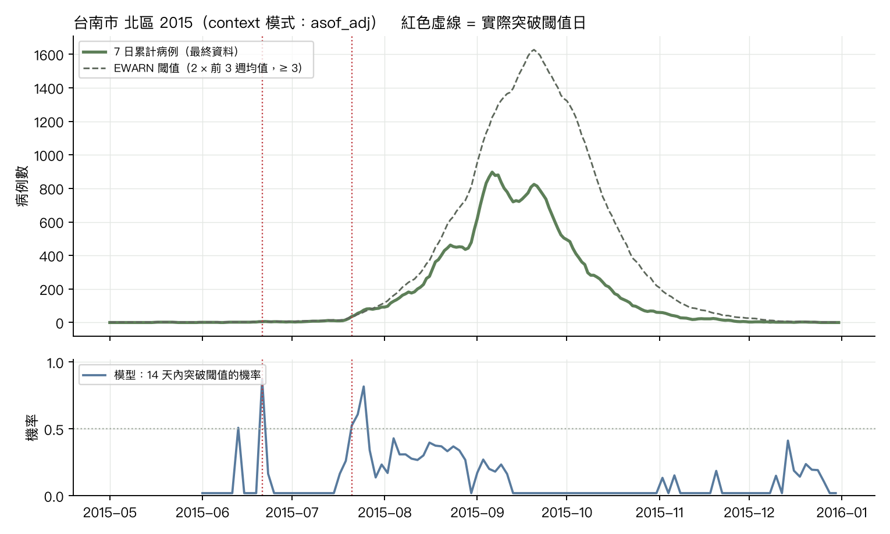
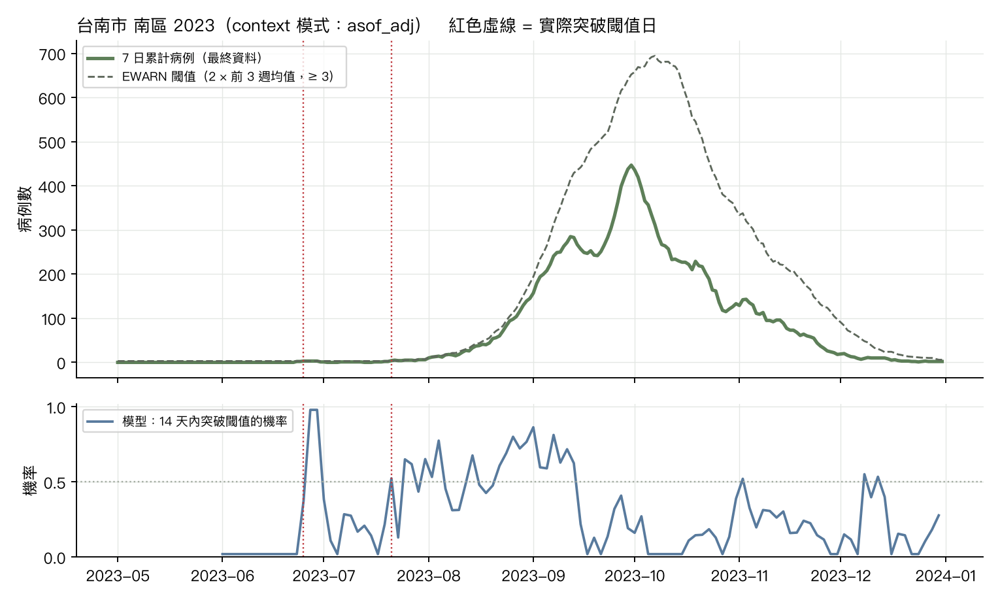

# 登革熱鄉鎮每日回測：閾值突破預警（CHG 情境一，第一版）

資料：登革熱每日確定病例（本土，居住鄉鎮），台南 37 區 + 高雄 38 區中 2012 起有病例的 274 區；目標 = 7 日累計病例；閾值 = max(2 × 前 3 週週均值, 3 例)（EWARN 規則加下限）。
起點：2010, 2011, 2012, 2013, 2014, 2015, 2016, 2018, 2019, 2020, 2023, 2024 年 6–12 月每 2 天；horizon 1–14 天；context 2 年（730 天）。模式：final = 以最終資料為 context（無通報延遲）、asof = 只用起點當日已通報者、asof_adj = as-of 除以歷史通報完整度。
事件（真值）= 最終資料的 7 日累計 ≥ 以最終資料計算的起點當日 EWARN 閾值，三種模式共用同一組事件；警示機率則用各模式在起點當日可得資料算出的閾值。面板自 2008-01-01 起；流行年 = 2010、2011、2012、2014、2015、2023（該年本土病例 ≥ 1,000）。

## 1. 7 日累計的分布預測表現（WIS 越低越好；cov80 理想 0.80）

|                                     |   WIS h=1 |   WIS h=3 |   WIS h=5 |   WIS h=7 |   WIS h=10 |   WIS h=14 |   cov80 h=7 |   cov80 h=14 |
|:------------------------------------|----------:|----------:|----------:|----------:|-----------:|-----------:|------------:|-------------:|
| ('asof_adj', 'ens_tfm_kde_mix')     |      0.22 |      0.28 |      0.34 |      0.4  |       0.49 |       0.63 |        0.95 |         0.96 |
| ('asof_adj', 'ens_tfm_kde_mix_fix') |      0.22 |      0.27 |      0.34 |      0.4  |       0.48 |       0.62 |        0.95 |         0.96 |
| ('asof_adj', 'kde_fix')             |      0.4  |      0.44 |      0.48 |      0.55 |       0.65 |       0.85 |        0.97 |         0.97 |
| ('asof_adj', 'kde_mix')             |      0.28 |      0.33 |      0.39 |      0.46 |       0.58 |       0.79 |        0.97 |         0.97 |
| ('asof_adj', 'kde_mix_fix')         |      0.28 |      0.33 |      0.39 |      0.46 |       0.57 |       0.78 |        0.97 |         0.97 |
| ('asof_adj', 'kde_rv')              |      0.39 |      0.43 |      0.48 |      0.55 |       0.66 |       0.86 |        0.97 |         0.97 |
| ('asof_adj', 'kde_rv_b2')           |      0.41 |      0.44 |      0.49 |      0.56 |       0.67 |       0.87 |        0.97 |         0.97 |
| ('asof_adj', 'kde_rv_season')       |      0.4  |      0.44 |      0.49 |      0.55 |       0.66 |       0.86 |        0.97 |         0.97 |
| ('asof_adj', 'naive')               |      0.3  |      0.36 |      0.43 |      0.49 |       0.56 |       0.66 |        0.94 |         0.94 |
| ('asof_adj', 'snaive')              |      1.42 |      1.43 |      1.44 |      1.45 |       1.47 |       1.48 |        0.93 |         0.93 |
| ('asof_adj', 'tfm')                 |      0.27 |      0.3  |      0.35 |      0.39 |       0.46 |       0.55 |        0.95 |         0.96 |

h = 7 的 WIS 依年份類型（流行年 = 2010、2011、2012、2014、2015、2023）：

|                                     |   流行年 |   非流行年 |
|:------------------------------------|------:|-------:|
| ('asof_adj', 'ens_tfm_kde_mix')     |  0.79 |   0.02 |
| ('asof_adj', 'ens_tfm_kde_mix_fix') |  0.77 |   0.02 |
| ('asof_adj', 'kde_fix')             |  1.07 |   0.02 |
| ('asof_adj', 'kde_mix')             |  0.91 |   0.02 |
| ('asof_adj', 'kde_mix_fix')         |  0.9  |   0.02 |
| ('asof_adj', 'kde_rv')              |  1.08 |   0.02 |
| ('asof_adj', 'kde_rv_b2')           |  1.09 |   0.02 |
| ('asof_adj', 'kde_rv_season')       |  1.08 |   0.02 |
| ('asof_adj', 'naive')               |  0.95 |   0.03 |
| ('asof_adj', 'snaive')              |  1.55 |   1.36 |
| ('asof_adj', 'tfm')                 |  0.77 |   0.02 |

h = 7 的 WIS 依區域：

|                                     |   其他縣市 |   台南高雄 |
|:------------------------------------|-------:|-------:|
| ('asof_adj', 'ens_tfm_kde_mix')     |   0.05 |   1.36 |
| ('asof_adj', 'ens_tfm_kde_mix_fix') |   0.05 |   1.34 |
| ('asof_adj', 'kde_fix')             |   0.06 |   1.86 |
| ('asof_adj', 'kde_mix')             |   0.05 |   1.58 |
| ('asof_adj', 'kde_mix_fix')         |   0.05 |   1.56 |
| ('asof_adj', 'kde_rv')              |   0.06 |   1.87 |
| ('asof_adj', 'kde_rv_b2')           |   0.06 |   1.9  |
| ('asof_adj', 'kde_rv_season')       |   0.06 |   1.88 |
| ('asof_adj', 'naive')               |   0.06 |   1.65 |
| ('asof_adj', 'snaive')              |   0.1  |   5.11 |
| ('asof_adj', 'tfm')                 |   0.05 |   1.32 |

## 2. 閾值突破預警：機率技巧與 p* 取捨

事件 = 未來 14 天內 7 日累計 ≥ 起點當日以最終資料計算的閾值（三種模式相同）；模型機率 = 各 horizon 機率的最大值（機率的閾值為該模式當日可得資料所算）。假警報率以「鄉鎮 × 週」計：該週任一起點發警示即算一次警示週，該週任一起點有事件即算事件週。

AUC（鄉鎮週層級，事件 vs 模型機率）：

| mode     |   ens_tfm_kde_mix |   ens_tfm_kde_mix_fix |   kde_fix |   kde_mix |   kde_mix_fix |   kde_rv |   kde_rv_b2 |   kde_rv_season |   naive |   snaive |   tfm |
|:---------|------------------:|----------------------:|----------:|----------:|--------------:|---------:|------------:|----------------:|--------:|---------:|------:|
| asof_adj |             0.899 |                 0.906 |     0.826 |     0.891 |         0.899 |    0.801 |       0.797 |            0.81 |   0.774 |    0.722 | 0.894 |

TimesFM（asof_adj）p* 掃描（103,024 鄉鎮週，其中事件週 2,103）：

|   p_star |   sensitivity |   false_alarm_per100 |   ppv |   alerts |
|---------:|--------------:|---------------------:|------:|---------:|
|      0.2 |         0.609 |                2.074 | 0.38  |     3374 |
|      0.3 |         0.502 |                1.356 | 0.435 |     2423 |
|      0.4 |         0.424 |                0.888 | 0.499 |     1788 |
|      0.5 |         0.343 |                0.612 | 0.538 |     1339 |
|      0.6 |         0.268 |                0.436 | 0.561 |     1003 |
|      0.7 |         0.205 |                0.33  | 0.564 |      764 |
|      0.8 |         0.139 |                0.2   | 0.592 |      495 |
|      0.9 |         0.08  |                0.088 | 0.655 |      258 |

ens_tfm_kde_mix（asof_adj）p* 掃描（103,024 鄉鎮週，其中事件週 2,103）：

|   p_star |   sensitivity |   false_alarm_per100 |   ppv |   alerts |
|---------:|--------------:|---------------------:|------:|---------:|
|      0.2 |         0.624 |                1.835 | 0.415 |     3165 |
|      0.3 |         0.508 |                1.165 | 0.476 |     2245 |
|      0.4 |         0.407 |                0.766 | 0.525 |     1628 |
|      0.5 |         0.309 |                0.483 | 0.572 |     1137 |
|      0.6 |         0.224 |                0.237 | 0.664 |      711 |
|      0.7 |         0.135 |                0.11  | 0.719 |      395 |
|      0.8 |         0.059 |                0.038 | 0.765 |      162 |
|      0.9 |         0.01  |                0.009 | 0.69  |       29 |

ens_tfm_kde_mix_fix（asof_adj）p* 掃描（103,024 鄉鎮週，其中事件週 2,103）：

|   p_star |   sensitivity |   false_alarm_per100 |   ppv |   alerts |
|---------:|--------------:|---------------------:|------:|---------:|
|      0.2 |         0.652 |                1.906 | 0.416 |     3295 |
|      0.3 |         0.539 |                1.229 | 0.477 |     2373 |
|      0.4 |         0.441 |                0.793 | 0.537 |     1727 |
|      0.5 |         0.342 |                0.507 | 0.584 |     1231 |
|      0.6 |         0.258 |                0.254 | 0.68  |      799 |
|      0.7 |         0.164 |                0.12  | 0.74  |      466 |
|      0.8 |         0.076 |                0.038 | 0.807 |      197 |
|      0.9 |         0.018 |                0.005 | 0.881 |       42 |

kde_fix（asof_adj）p* 掃描（103,024 鄉鎮週，其中事件週 2,103）：

|   p_star |   sensitivity |   false_alarm_per100 |   ppv |   alerts |
|---------:|--------------:|---------------------:|------:|---------:|
|      0.2 |         0.414 |                1.24  | 0.41  |     2121 |
|      0.3 |         0.382 |                1.112 | 0.417 |     1926 |
|      0.4 |         0.341 |                0.872 | 0.449 |     1598 |
|      0.5 |         0.294 |                0.68  | 0.474 |     1304 |
|      0.6 |         0.253 |                0.512 | 0.507 |     1049 |
|      0.7 |         0.207 |                0.37  | 0.539 |      809 |
|      0.8 |         0.162 |                0.232 | 0.593 |      575 |
|      0.9 |         0.097 |                0.101 | 0.666 |      305 |

kde_mix（asof_adj）p* 掃描（103,024 鄉鎮週，其中事件週 2,103）：

|   p_star |   sensitivity |   false_alarm_per100 |   ppv |   alerts |
|---------:|--------------:|---------------------:|------:|---------:|
|      0.2 |         0.578 |                1.583 | 0.432 |     2813 |
|      0.3 |         0.505 |                1.317 | 0.444 |     2391 |
|      0.4 |         0.41  |                0.876 | 0.494 |     1747 |
|      0.5 |         0.338 |                0.599 | 0.54  |     1315 |
|      0.6 |         0.271 |                0.39  | 0.591 |      964 |
|      0.7 |         0.2   |                0.233 | 0.642 |      656 |
|      0.8 |         0.126 |                0.105 | 0.714 |      371 |
|      0.9 |         0.036 |                0.037 | 0.67  |      112 |

kde_mix_fix（asof_adj）p* 掃描（103,024 鄉鎮週，其中事件週 2,103）：

|   p_star |   sensitivity |   false_alarm_per100 |   ppv |   alerts |
|---------:|--------------:|---------------------:|------:|---------:|
|      0.2 |         0.614 |                1.689 | 0.431 |     2997 |
|      0.3 |         0.543 |                1.438 | 0.44  |     2593 |
|      0.4 |         0.448 |                0.972 | 0.49  |     1923 |
|      0.5 |         0.374 |                0.674 | 0.536 |     1466 |
|      0.6 |         0.308 |                0.456 | 0.585 |     1108 |
|      0.7 |         0.245 |                0.266 | 0.658 |      783 |
|      0.8 |         0.162 |                0.127 | 0.726 |      468 |
|      0.9 |         0.059 |                0.034 | 0.786 |      159 |

kde_rv（asof_adj）p* 掃描（103,024 鄉鎮週，其中事件週 2,103）：

|   p_star |   sensitivity |   false_alarm_per100 |   ppv |   alerts |
|---------:|--------------:|---------------------:|------:|---------:|
|      0.2 |         0.347 |                1.046 | 0.408 |     1785 |
|      0.3 |         0.318 |                0.93  | 0.416 |     1608 |
|      0.4 |         0.275 |                0.73  | 0.44  |     1315 |
|      0.5 |         0.237 |                0.573 | 0.463 |     1076 |
|      0.6 |         0.202 |                0.421 | 0.499 |      849 |
|      0.7 |         0.154 |                0.308 | 0.51  |      635 |
|      0.8 |         0.109 |                0.177 | 0.562 |      409 |
|      0.9 |         0.049 |                0.078 | 0.564 |      181 |

kde_rv_b2（asof_adj）p* 掃描（103,024 鄉鎮週，其中事件週 2,103）：

|   p_star |   sensitivity |   false_alarm_per100 |   ppv |   alerts |
|---------:|--------------:|---------------------:|------:|---------:|
|      0.2 |         0.347 |                1.053 | 0.407 |     1792 |
|      0.3 |         0.322 |                0.941 | 0.416 |     1628 |
|      0.4 |         0.28  |                0.744 | 0.44  |     1340 |
|      0.5 |         0.249 |                0.592 | 0.467 |     1121 |
|      0.6 |         0.212 |                0.444 | 0.498 |      893 |
|      0.7 |         0.176 |                0.316 | 0.538 |      690 |
|      0.8 |         0.129 |                0.195 | 0.58  |      469 |
|      0.9 |         0.068 |                0.089 | 0.614 |      233 |

kde_rv_season（asof_adj）p* 掃描（103,024 鄉鎮週，其中事件週 2,103）：

|   p_star |   sensitivity |   false_alarm_per100 |   ppv |   alerts |
|---------:|--------------:|---------------------:|------:|---------:|
|      0.2 |         0.388 |                1.364 | 0.372 |     2193 |
|      0.3 |         0.359 |                1.257 | 0.373 |     2024 |
|      0.4 |         0.305 |                0.984 | 0.392 |     1634 |
|      0.5 |         0.267 |                0.776 | 0.418 |     1345 |
|      0.6 |         0.227 |                0.589 | 0.446 |     1072 |
|      0.7 |         0.178 |                0.433 | 0.462 |      812 |
|      0.8 |         0.13  |                0.258 | 0.513 |      534 |
|      0.9 |         0.075 |                0.105 | 0.597 |      263 |

分層（asof_adj，各預測模型）：區域 × 起點的事件型態。下限群聚 = 起點閾值在 3 例下限（非流行區的第一個群聚）；流行中加速 = 閾值高於下限（流行已在進行）。

| model               | 區域   | 事件型態   |   鄉鎮週 |   事件週 |   AUC |   p_star |   敏感度 |   假警報/100 |   PPV |
|:--------------------|:-----|:-------|------:|------:|------:|---------:|------:|----------:|------:|
| tfm                 | 其他縣市 | 下限群聚   | 74724 |   294 | 0.784 |      0.3 | 0.238 |     0.508 | 0.156 |
| tfm                 | 其他縣市 | 下限群聚   | 74724 |   294 | 0.784 |      0.5 | 0.18  |     0.331 | 0.177 |
| tfm                 | 其他縣市 | 流行中加速  |   476 |   169 | 0.687 |      0.3 | 0.675 |    44.625 | 0.454 |
| tfm                 | 其他縣市 | 流行中加速  |   476 |   169 | 0.687 |      0.5 | 0.45  |    11.726 | 0.679 |
| tfm                 | 台南高雄 | 下限群聚   | 25194 |   601 | 0.797 |      0.3 | 0.291 |     1.504 | 0.321 |
| tfm                 | 台南高雄 | 下限群聚   | 25194 |   601 | 0.797 |      0.5 | 0.22  |     0.825 | 0.394 |
| tfm                 | 台南高雄 | 流行中加速  |  2630 |  1039 | 0.768 |      0.3 | 0.67  |    30.358 | 0.59  |
| tfm                 | 台南高雄 | 流行中加速  |  2630 |  1039 | 0.768 |      0.5 | 0.443 |     8.36  | 0.776 |
| ens_tfm_kde_mix     | 其他縣市 | 下限群聚   | 74724 |   294 | 0.788 |      0.3 | 0.235 |     0.512 | 0.153 |
| ens_tfm_kde_mix     | 其他縣市 | 下限群聚   | 74724 |   294 | 0.788 |      0.5 | 0.133 |     0.254 | 0.171 |
| ens_tfm_kde_mix     | 其他縣市 | 流行中加速  |   476 |   169 | 0.715 |      0.3 | 0.592 |    23.779 | 0.578 |
| ens_tfm_kde_mix     | 其他縣市 | 流行中加速  |   476 |   169 | 0.715 |      0.5 | 0.337 |     6.515 | 0.74  |
| ens_tfm_kde_mix     | 台南高雄 | 下限群聚   | 25194 |   601 | 0.818 |      0.3 | 0.311 |     1.171 | 0.394 |
| ens_tfm_kde_mix     | 台南高雄 | 下限群聚   | 25194 |   601 | 0.818 |      0.5 | 0.183 |     0.48  | 0.482 |
| ens_tfm_kde_mix     | 台南高雄 | 流行中加速  |  2630 |  1039 | 0.774 |      0.3 | 0.686 |    27.278 | 0.622 |
| ens_tfm_kde_mix     | 台南高雄 | 流行中加速  |  2630 |  1039 | 0.774 |      0.5 | 0.427 |    10.057 | 0.735 |
| ens_tfm_kde_mix_fix | 其他縣市 | 下限群聚   | 74724 |   294 | 0.791 |      0.3 | 0.248 |     0.544 | 0.153 |
| ens_tfm_kde_mix_fix | 其他縣市 | 下限群聚   | 74724 |   294 | 0.791 |      0.5 | 0.136 |     0.25  | 0.177 |
| ens_tfm_kde_mix_fix | 其他縣市 | 流行中加速  |   476 |   169 | 0.728 |      0.3 | 0.568 |    21.824 | 0.589 |
| ens_tfm_kde_mix_fix | 其他縣市 | 流行中加速  |   476 |   169 | 0.728 |      0.5 | 0.355 |     6.189 | 0.759 |
| ens_tfm_kde_mix_fix | 台南高雄 | 下限群聚   | 25194 |   601 | 0.837 |      0.3 | 0.373 |     1.33  | 0.407 |
| ens_tfm_kde_mix_fix | 台南高雄 | 下限群聚   | 25194 |   601 | 0.837 |      0.5 | 0.236 |     0.606 | 0.488 |
| ens_tfm_kde_mix_fix | 台南高雄 | 流行中加速  |  2630 |  1039 | 0.788 |      0.3 | 0.712 |    27.718 | 0.627 |
| ens_tfm_kde_mix_fix | 台南高雄 | 流行中加速  |  2630 |  1039 | 0.788 |      0.5 | 0.459 |     9.931 | 0.751 |
| kde_fix             | 其他縣市 | 下限群聚   | 74724 |   294 | 0.696 |      0.3 | 0.058 |     0.472 | 0.046 |
| kde_fix             | 其他縣市 | 下限群聚   | 74724 |   294 | 0.696 |      0.5 | 0.024 |     0.31  | 0.029 |
| kde_fix             | 其他縣市 | 流行中加速  |   476 |   169 | 0.816 |      0.3 | 0.249 |     8.795 | 0.609 |
| kde_fix             | 其他縣市 | 流行中加速  |   476 |   169 | 0.816 |      0.5 | 0.183 |     5.212 | 0.66  |
| kde_fix             | 台南高雄 | 下限群聚   | 25194 |   601 | 0.794 |      0.3 | 0.321 |     1.256 | 0.384 |
| kde_fix             | 台南高雄 | 下限群聚   | 25194 |   601 | 0.794 |      0.5 | 0.245 |     0.683 | 0.467 |
| kde_fix             | 台南高雄 | 流行中加速  |  2630 |  1039 | 0.758 |      0.3 | 0.531 |    27.341 | 0.559 |
| kde_fix             | 台南高雄 | 流行中加速  |  2630 |  1039 | 0.758 |      0.5 | 0.417 |    17.033 | 0.615 |
| kde_mix             | 其他縣市 | 下限群聚   | 74724 |   294 | 0.777 |      0.3 | 0.262 |     0.67  | 0.134 |
| kde_mix             | 其他縣市 | 下限群聚   | 74724 |   294 | 0.777 |      0.5 | 0.119 |     0.269 | 0.149 |
| kde_mix             | 其他縣市 | 流行中加速  |   476 |   169 | 0.725 |      0.3 | 0.509 |    21.173 | 0.57  |
| kde_mix             | 其他縣市 | 流行中加速  |   476 |   169 | 0.725 |      0.5 | 0.284 |    10.098 | 0.608 |
| kde_mix             | 台南高雄 | 下限群聚   | 25194 |   601 | 0.817 |      0.3 | 0.349 |     1.187 | 0.418 |
| kde_mix             | 台南高雄 | 下限群聚   | 25194 |   601 | 0.817 |      0.5 | 0.198 |     0.52  | 0.482 |
| kde_mix             | 台南高雄 | 流行中加速  |  2630 |  1039 | 0.755 |      0.3 | 0.663 |    29.73  | 0.593 |
| kde_mix             | 台南高雄 | 流行中加速  |  2630 |  1039 | 0.755 |      0.5 | 0.489 |    15.462 | 0.674 |
| kde_mix_fix         | 其他縣市 | 下限群聚   | 74724 |   294 | 0.775 |      0.3 | 0.276 |     0.709 | 0.133 |
| kde_mix_fix         | 其他縣市 | 下限群聚   | 74724 |   294 | 0.775 |      0.5 | 0.126 |     0.305 | 0.14  |
| kde_mix_fix         | 其他縣市 | 流行中加速  |   476 |   169 | 0.751 |      0.3 | 0.509 |    18.567 | 0.601 |
| kde_mix_fix         | 其他縣市 | 流行中加速  |   476 |   169 | 0.751 |      0.5 | 0.302 |     9.446 | 0.638 |
| kde_mix_fix         | 台南高雄 | 下限群聚   | 25194 |   601 | 0.845 |      0.3 | 0.436 |     1.525 | 0.411 |
| kde_mix_fix         | 台南高雄 | 下限群聚   | 25194 |   601 | 0.845 |      0.5 | 0.273 |     0.72  | 0.481 |
| kde_mix_fix         | 台南高雄 | 流行中加速  |  2630 |  1039 | 0.764 |      0.3 | 0.686 |    30.861 | 0.592 |
| kde_mix_fix         | 台南高雄 | 流行中加速  |  2630 |  1039 | 0.764 |      0.5 | 0.514 |    15.525 | 0.684 |
| kde_rv              | 其他縣市 | 下限群聚   | 74724 |   294 | 0.678 |      0.3 | 0.034 |     0.422 | 0.031 |
| kde_rv              | 其他縣市 | 下限群聚   | 74724 |   294 | 0.678 |      0.5 | 0.027 |     0.278 | 0.037 |
| kde_rv              | 其他縣市 | 流行中加速  |   476 |   169 | 0.774 |      0.3 | 0.254 |    10.098 | 0.581 |
| kde_rv              | 其他縣市 | 流行中加速  |   476 |   169 | 0.774 |      0.5 | 0.172 |     7.818 | 0.547 |
| kde_rv              | 台南高雄 | 下限群聚   | 25194 |   601 | 0.748 |      0.3 | 0.186 |     0.61  | 0.427 |
| kde_rv              | 台南高雄 | 下限群聚   | 25194 |   601 | 0.748 |      0.5 | 0.13  |     0.321 | 0.497 |
| kde_rv              | 台南高雄 | 流行中加速  |  2630 |  1039 | 0.729 |      0.3 | 0.485 |    27.907 | 0.532 |
| kde_rv              | 台南高雄 | 流行中加速  |  2630 |  1039 | 0.729 |      0.5 | 0.369 |    16.845 | 0.588 |
| kde_rv_b2           | 其他縣市 | 下限群聚   | 74724 |   294 | 0.677 |      0.3 | 0.034 |     0.442 | 0.029 |
| kde_rv_b2           | 其他縣市 | 下限群聚   | 74724 |   294 | 0.677 |      0.5 | 0.024 |     0.286 | 0.032 |
| kde_rv_b2           | 其他縣市 | 流行中加速  |   476 |   169 | 0.79  |      0.3 | 0.189 |     9.446 | 0.525 |
| kde_rv_b2           | 其他縣市 | 流行中加速  |   476 |   169 | 0.79  |      0.5 | 0.136 |     6.84  | 0.523 |
| kde_rv_b2           | 台南高雄 | 下限群聚   | 25194 |   601 | 0.757 |      0.3 | 0.218 |     0.699 | 0.432 |
| kde_rv_b2           | 台南高雄 | 下限群聚   | 25194 |   601 | 0.757 |      0.5 | 0.168 |     0.415 | 0.498 |
| kde_rv_b2           | 台南高雄 | 流行中加速  |  2630 |  1039 | 0.743 |      0.3 | 0.486 |    26.398 | 0.546 |
| kde_rv_b2           | 台南高雄 | 流行中加速  |  2630 |  1039 | 0.743 |      0.5 | 0.378 |    16.405 | 0.601 |
| kde_rv_season       | 其他縣市 | 下限群聚   | 74724 |   294 | 0.695 |      0.3 | 0.068 |     0.528 | 0.048 |
| kde_rv_season       | 其他縣市 | 下限群聚   | 74724 |   294 | 0.695 |      0.5 | 0.048 |     0.349 | 0.051 |
| kde_rv_season       | 其他縣市 | 流行中加速  |   476 |   169 | 0.793 |      0.3 | 0.243 |    11.726 | 0.532 |
| kde_rv_season       | 其他縣市 | 流行中加速  |   476 |   169 | 0.793 |      0.5 | 0.183 |     8.469 | 0.544 |
| kde_rv_season       | 台南高雄 | 下限群聚   | 25194 |   601 | 0.768 |      0.3 | 0.275 |     1.606 | 0.295 |
| kde_rv_season       | 台南高雄 | 下限群聚   | 25194 |   601 | 0.768 |      0.5 | 0.196 |     0.956 | 0.334 |
| kde_rv_season       | 台南高雄 | 流行中加速  |  2630 |  1039 | 0.747 |      0.3 | 0.509 |    27.97  | 0.543 |
| kde_rv_season       | 台南高雄 | 流行中加速  |  2630 |  1039 | 0.747 |      0.5 | 0.384 |    16.468 | 0.604 |

## 3. 前置時間：模型預警 vs EWARN 靜態規則、EWMA、CUSUM

事件（episode）= 最終資料的 7 日累計首次達到當日 EWARN 閾值，且之前至少 14 天低於閾值。EWARN 靜態規則在事件當天才觸發（前置 0 天）。模型：事件前 14 天內最早發出警示（機率 ≥ p*）的起點到事件日的天數；EWMA/CUSUM：事件前 14 天內最早的警報日。

事件數（2010, 2011, 2012, 2013, 2014, 2015, 2016, 2018, 2019, 2020, 2023, 2024 年 6–12 月）：441，其中流行年 404。

| 方法                                  |   偵測到的事件比例 |   前置時間中位數（天） |   前置 ≥ 3 天的比例 |
|:------------------------------------|-----------:|-------------:|--------------:|
| EWARN 靜態規則                          |       1    |          0   |          0    |
| EWMA                                |       0.07 |          2   |          0.02 |
| CUSUM                               |       0.5  |          0   |          0.15 |
| TimesFM asof_adj p*=0.3             |       0.48 |          5   |          0.32 |
| TimesFM asof_adj p*=0.5             |       0.34 |          4   |          0.2  |
| TimesFM asof_adj p*=0.7             |       0.19 |          3   |          0.11 |
| ens_tfm_kde_mix asof_adj p*=0.3     |       0.49 |          5   |          0.32 |
| ens_tfm_kde_mix asof_adj p*=0.5     |       0.27 |          4   |          0.17 |
| ens_tfm_kde_mix asof_adj p*=0.7     |       0.08 |          6.5 |          0.06 |
| ens_tfm_kde_mix_fix asof_adj p*=0.3 |       0.53 |          5   |          0.37 |
| ens_tfm_kde_mix_fix asof_adj p*=0.5 |       0.32 |          5   |          0.22 |
| ens_tfm_kde_mix_fix asof_adj p*=0.7 |       0.13 |          8   |          0.1  |
| kde_fix asof_adj p*=0.3             |       0.37 |         13   |          0.34 |
| kde_fix asof_adj p*=0.5             |       0.28 |         11   |          0.25 |
| kde_fix asof_adj p*=0.7             |       0.21 |          9.5 |          0.18 |
| kde_mix asof_adj p*=0.3             |       0.53 |          7   |          0.38 |
| kde_mix asof_adj p*=0.5             |       0.31 |          5.5 |          0.21 |
| kde_mix asof_adj p*=0.7             |       0.17 |          6   |          0.12 |
| kde_mix_fix asof_adj p*=0.3         |       0.59 |          7   |          0.44 |
| kde_mix_fix asof_adj p*=0.5         |       0.38 |          7   |          0.27 |
| kde_mix_fix asof_adj p*=0.7         |       0.22 |          8   |          0.17 |
| kde_rv asof_adj p*=0.3              |       0.26 |         11   |          0.23 |
| kde_rv asof_adj p*=0.5              |       0.22 |          9   |          0.17 |
| kde_rv asof_adj p*=0.7              |       0.16 |          7.5 |          0.13 |
| kde_rv_b2 asof_adj p*=0.3           |       0.27 |         13   |          0.25 |
| kde_rv_b2 asof_adj p*=0.5           |       0.22 |         12   |          0.2  |
| kde_rv_b2 asof_adj p*=0.7           |       0.18 |         10   |          0.16 |
| kde_rv_season asof_adj p*=0.3       |       0.31 |         13   |          0.29 |
| kde_rv_season asof_adj p*=0.5       |       0.24 |         13   |          0.22 |
| kde_rv_season asof_adj p*=0.7       |       0.18 |         12   |          0.17 |

統計偵測器在非事件期間（事件前後 14 天以外）的假警報：

| 方法    |   非事件鄉鎮週數 |   假警報週 |   每 100 鄉鎮週假警報 |
|:------|----------:|-------:|---------------:|
| EWMA  |    102128 |    219 |           0.21 |
| CUSUM |    102128 |    683 |           0.67 |

配對比較：在不高於各偵測器假警報率的 p* 下，模型的敏感度與前置時間：

| 對照偵測器   |   其假警報/100 鄉鎮週 | 模式       | 模型                  |   模型 p* |   模型假警報/100 |   模型敏感度（週） |   模型偵測事件比例 |   模型前置中位數（天） |
|:--------|---------------:|:---------|:--------------------|--------:|------------:|-----------:|-----------:|-------------:|
| EWMA    |           0.21 | asof_adj | TimesFM             |     0.8 |        0.2  |      0.139 |       0.13 |          2   |
| EWMA    |           0.21 | asof_adj | ens_tfm_kde_mix     |     0.7 |        0.11 |      0.135 |       0.08 |          6.5 |
| EWMA    |           0.21 | asof_adj | ens_tfm_kde_mix_fix |     0.7 |        0.12 |      0.164 |       0.13 |          8   |
| EWMA    |           0.21 | asof_adj | kde_fix             |     0.9 |        0.1  |      0.097 |       0.11 |         12   |
| EWMA    |           0.21 | asof_adj | kde_mix             |     0.8 |        0.11 |      0.126 |       0.1  |          7   |
| EWMA    |           0.21 | asof_adj | kde_mix_fix         |     0.8 |        0.13 |      0.162 |       0.16 |          6   |
| EWMA    |           0.21 | asof_adj | kde_rv              |     0.8 |        0.18 |      0.109 |       0.1  |          8.5 |
| EWMA    |           0.21 | asof_adj | kde_rv_b2           |     0.8 |        0.2  |      0.129 |       0.13 |         10   |
| EWMA    |           0.21 | asof_adj | kde_rv_season       |     0.9 |        0.11 |      0.075 |       0.09 |         12.5 |
| CUSUM   |           0.67 | asof_adj | TimesFM             |     0.5 |        0.61 |      0.343 |       0.34 |          4   |
| CUSUM   |           0.67 | asof_adj | ens_tfm_kde_mix     |     0.5 |        0.48 |      0.309 |       0.27 |          4   |
| CUSUM   |           0.67 | asof_adj | ens_tfm_kde_mix_fix |     0.5 |        0.51 |      0.342 |       0.32 |          5   |
| CUSUM   |           0.67 | asof_adj | kde_fix             |     0.6 |        0.51 |      0.253 |       0.25 |         10.5 |
| CUSUM   |           0.67 | asof_adj | kde_mix             |     0.5 |        0.6  |      0.338 |       0.31 |          5.5 |
| CUSUM   |           0.67 | asof_adj | kde_mix_fix         |     0.6 |        0.46 |      0.308 |       0.3  |          7   |
| CUSUM   |           0.67 | asof_adj | kde_rv              |     0.5 |        0.57 |      0.237 |       0.22 |          9   |
| CUSUM   |           0.67 | asof_adj | kde_rv_b2           |     0.5 |        0.59 |      0.249 |       0.22 |         12   |
| CUSUM   |           0.67 | asof_adj | kde_rv_season       |     0.6 |        0.59 |      0.227 |       0.2  |         13   |

分層的前置時間：區域 × 事件型態（依突破當日的最終資料閾值；下限群聚 = 閾值在 3 例下限）：

| 區域   | 事件型態   |   事件數 |   其中平靜年 | 方法                                  |   偵測到的事件比例 |   前置時間中位數（天） |   前置 ≥ 3 天的比例 |
|:-----|:-------|------:|--------:|:------------------------------------|-----------:|-------------:|--------------:|
| 其他縣市 | 下限群聚   |    91 |      17 | EWMA                                |       0    |        nan   |        nan    |
| 其他縣市 | 下限群聚   |    91 |      17 | CUSUM                               |       0.35 |          0   |          0.01 |
| 其他縣市 | 下限群聚   |    91 |      17 | TimesFM asof_adj p*=0.3             |       0.33 |          3   |          0.18 |
| 其他縣市 | 下限群聚   |    91 |      17 | TimesFM asof_adj p*=0.5             |       0.24 |          3.5 |          0.13 |
| 其他縣市 | 下限群聚   |    91 |      17 | ens_tfm_kde_mix asof_adj p*=0.3     |       0.31 |          2   |          0.13 |
| 其他縣市 | 下限群聚   |    91 |      17 | ens_tfm_kde_mix asof_adj p*=0.5     |       0.16 |          2   |          0.08 |
| 其他縣市 | 下限群聚   |    91 |      17 | ens_tfm_kde_mix_fix asof_adj p*=0.3 |       0.34 |          2   |          0.16 |
| 其他縣市 | 下限群聚   |    91 |      17 | ens_tfm_kde_mix_fix asof_adj p*=0.5 |       0.19 |          2   |          0.08 |
| 其他縣市 | 下限群聚   |    91 |      17 | kde_fix asof_adj p*=0.3             |       0.05 |          5   |          0.05 |
| 其他縣市 | 下限群聚   |    91 |      17 | kde_fix asof_adj p*=0.5             |       0.02 |          2.5 |          0.01 |
| 其他縣市 | 下限群聚   |    91 |      17 | kde_mix asof_adj p*=0.3             |       0.33 |          4   |          0.19 |
| 其他縣市 | 下限群聚   |    91 |      17 | kde_mix asof_adj p*=0.5             |       0.15 |          2.5 |          0.08 |
| 其他縣市 | 下限群聚   |    91 |      17 | kde_mix_fix asof_adj p*=0.3         |       0.35 |          4   |          0.21 |
| 其他縣市 | 下限群聚   |    91 |      17 | kde_mix_fix asof_adj p*=0.5         |       0.18 |          2   |          0.08 |
| 其他縣市 | 下限群聚   |    91 |      17 | kde_rv asof_adj p*=0.3              |       0.04 |          6.5 |          0.03 |
| 其他縣市 | 下限群聚   |    91 |      17 | kde_rv asof_adj p*=0.5              |       0.04 |          3   |          0.02 |
| 其他縣市 | 下限群聚   |    91 |      17 | kde_rv_b2 asof_adj p*=0.3           |       0.04 |          4.5 |          0.03 |
| 其他縣市 | 下限群聚   |    91 |      17 | kde_rv_b2 asof_adj p*=0.5           |       0.03 |          2   |          0.01 |
| 其他縣市 | 下限群聚   |    91 |      17 | kde_rv_season asof_adj p*=0.3       |       0.08 |         11   |          0.07 |
| 其他縣市 | 下限群聚   |    91 |      17 | kde_rv_season asof_adj p*=0.5       |       0.05 |          5   |          0.04 |
| 其他縣市 | 流行中加速  |    31 |       9 | EWMA                                |       0    |        nan   |        nan    |
| 其他縣市 | 流行中加速  |    31 |       9 | CUSUM                               |       0.77 |          2   |          0.26 |
| 其他縣市 | 流行中加速  |    31 |       9 | TimesFM asof_adj p*=0.3             |       0.68 |          4   |          0.48 |
| 其他縣市 | 流行中加速  |    31 |       9 | TimesFM asof_adj p*=0.5             |       0.39 |          3   |          0.23 |
| 其他縣市 | 流行中加速  |    31 |       9 | ens_tfm_kde_mix asof_adj p*=0.3     |       0.55 |          5   |          0.39 |
| 其他縣市 | 流行中加速  |    31 |       9 | ens_tfm_kde_mix asof_adj p*=0.5     |       0.35 |          4   |          0.19 |
| 其他縣市 | 流行中加速  |    31 |       9 | ens_tfm_kde_mix_fix asof_adj p*=0.3 |       0.55 |          4   |          0.39 |
| 其他縣市 | 流行中加速  |    31 |       9 | ens_tfm_kde_mix_fix asof_adj p*=0.5 |       0.35 |          4   |          0.23 |
| 其他縣市 | 流行中加速  |    31 |       9 | kde_fix asof_adj p*=0.3             |       0.35 |         12   |          0.32 |
| 其他縣市 | 流行中加速  |    31 |       9 | kde_fix asof_adj p*=0.5             |       0.32 |          6   |          0.29 |
| 其他縣市 | 流行中加速  |    31 |       9 | kde_mix asof_adj p*=0.3             |       0.58 |          6   |          0.39 |
| 其他縣市 | 流行中加速  |    31 |       9 | kde_mix asof_adj p*=0.5             |       0.35 |          4   |          0.23 |
| 其他縣市 | 流行中加速  |    31 |       9 | kde_mix_fix asof_adj p*=0.3         |       0.55 |          4   |          0.35 |
| 其他縣市 | 流行中加速  |    31 |       9 | kde_mix_fix asof_adj p*=0.5         |       0.39 |          4   |          0.23 |
| 其他縣市 | 流行中加速  |    31 |       9 | kde_rv asof_adj p*=0.3              |       0.29 |          7   |          0.26 |
| 其他縣市 | 流行中加速  |    31 |       9 | kde_rv asof_adj p*=0.5              |       0.23 |          7   |          0.19 |
| 其他縣市 | 流行中加速  |    31 |       9 | kde_rv_b2 asof_adj p*=0.3           |       0.26 |          7   |          0.23 |
| 其他縣市 | 流行中加速  |    31 |       9 | kde_rv_b2 asof_adj p*=0.5           |       0.23 |          7   |          0.19 |
| 其他縣市 | 流行中加速  |    31 |       9 | kde_rv_season asof_adj p*=0.3       |       0.32 |         13   |          0.29 |
| 其他縣市 | 流行中加速  |    31 |       9 | kde_rv_season asof_adj p*=0.5       |       0.29 |         13   |          0.26 |
| 台南高雄 | 下限群聚   |   175 |       9 | EWMA                                |       0    |        nan   |        nan    |
| 台南高雄 | 下限群聚   |   175 |       9 | CUSUM                               |       0.27 |          0   |          0.01 |
| 台南高雄 | 下限群聚   |   175 |       9 | TimesFM asof_adj p*=0.3             |       0.39 |          3   |          0.22 |
| 台南高雄 | 下限群聚   |   175 |       9 | TimesFM asof_adj p*=0.5             |       0.28 |          2   |          0.13 |
| 台南高雄 | 下限群聚   |   175 |       9 | ens_tfm_kde_mix asof_adj p*=0.3     |       0.39 |          4   |          0.22 |
| 台南高雄 | 下限群聚   |   175 |       9 | ens_tfm_kde_mix asof_adj p*=0.5     |       0.22 |          2.5 |          0.11 |
| 台南高雄 | 下限群聚   |   175 |       9 | ens_tfm_kde_mix_fix asof_adj p*=0.3 |       0.46 |          4   |          0.29 |
| 台南高雄 | 下限群聚   |   175 |       9 | ens_tfm_kde_mix_fix asof_adj p*=0.5 |       0.26 |          4   |          0.15 |
| 台南高雄 | 下限群聚   |   175 |       9 | kde_fix asof_adj p*=0.3             |       0.37 |         12   |          0.31 |
| 台南高雄 | 下限群聚   |   175 |       9 | kde_fix asof_adj p*=0.5             |       0.27 |          9   |          0.22 |
| 台南高雄 | 下限群聚   |   175 |       9 | kde_mix asof_adj p*=0.3             |       0.47 |          5   |          0.31 |
| 台南高雄 | 下限群聚   |   175 |       9 | kde_mix asof_adj p*=0.5             |       0.25 |          4   |          0.13 |
| 台南高雄 | 下限群聚   |   175 |       9 | kde_mix_fix asof_adj p*=0.3         |       0.57 |          5   |          0.41 |
| 台南高雄 | 下限群聚   |   175 |       9 | kde_mix_fix asof_adj p*=0.5         |       0.34 |          5   |          0.21 |
| 台南高雄 | 下限群聚   |   175 |       9 | kde_rv asof_adj p*=0.3              |       0.19 |         11.5 |          0.16 |
| 台南高雄 | 下限群聚   |   175 |       9 | kde_rv asof_adj p*=0.5              |       0.17 |          9   |          0.13 |
| 台南高雄 | 下限群聚   |   175 |       9 | kde_rv_b2 asof_adj p*=0.3           |       0.24 |         12.5 |          0.22 |
| 台南高雄 | 下限群聚   |   175 |       9 | kde_rv_b2 asof_adj p*=0.5           |       0.18 |          9.5 |          0.16 |
| 台南高雄 | 下限群聚   |   175 |       9 | kde_rv_season asof_adj p*=0.3       |       0.27 |         13   |          0.26 |
| 台南高雄 | 下限群聚   |   175 |       9 | kde_rv_season asof_adj p*=0.5       |       0.23 |         13   |          0.21 |
| 台南高雄 | 流行中加速  |   144 |       2 | EWMA                                |       0.2  |          2   |          0.08 |
| 台南高雄 | 流行中加速  |   144 |       2 | CUSUM                               |       0.81 |          2   |          0.38 |
| 台南高雄 | 流行中加速  |   144 |       2 | TimesFM asof_adj p*=0.3             |       0.64 |          9   |          0.51 |
| 台南高雄 | 流行中加速  |   144 |       2 | TimesFM asof_adj p*=0.5             |       0.46 |          6   |          0.31 |
| 台南高雄 | 流行中加速  |   144 |       2 | ens_tfm_kde_mix asof_adj p*=0.3     |       0.69 |          8   |          0.55 |
| 台南高雄 | 流行中加速  |   144 |       2 | ens_tfm_kde_mix asof_adj p*=0.5     |       0.4  |          8   |          0.3  |
| 台南高雄 | 流行中加速  |   144 |       2 | ens_tfm_kde_mix_fix asof_adj p*=0.3 |       0.74 |         10   |          0.59 |
| 台南高雄 | 流行中加速  |   144 |       2 | ens_tfm_kde_mix_fix asof_adj p*=0.5 |       0.49 |          9   |          0.4  |
| 台南高雄 | 流行中加速  |   144 |       2 | kde_fix asof_adj p*=0.3             |       0.57 |         13   |          0.55 |
| 台南高雄 | 流行中加速  |   144 |       2 | kde_fix asof_adj p*=0.5             |       0.45 |         13   |          0.44 |
| 台南高雄 | 流行中加速  |   144 |       2 | kde_mix asof_adj p*=0.3             |       0.71 |         10.5 |          0.59 |
| 台南高雄 | 流行中加速  |   144 |       2 | kde_mix asof_adj p*=0.5             |       0.49 |          9   |          0.39 |
| 台南高雄 | 流行中加速  |   144 |       2 | kde_mix_fix asof_adj p*=0.3         |       0.78 |         11.5 |          0.66 |
| 台南高雄 | 流行中加速  |   144 |       2 | kde_mix_fix asof_adj p*=0.5         |       0.55 |         11   |          0.47 |
| 台南高雄 | 流行中加速  |   144 |       2 | kde_rv asof_adj p*=0.3              |       0.47 |         13   |          0.42 |
| 台南高雄 | 流行中加速  |   144 |       2 | kde_rv asof_adj p*=0.5              |       0.38 |         12   |          0.32 |
| 台南高雄 | 流行中加速  |   144 |       2 | kde_rv_b2 asof_adj p*=0.3           |       0.45 |         13   |          0.42 |
| 台南高雄 | 流行中加速  |   144 |       2 | kde_rv_b2 asof_adj p*=0.5           |       0.4  |         13   |          0.37 |
| 台南高雄 | 流行中加速  |   144 |       2 | kde_rv_season asof_adj p*=0.3       |       0.49 |         13   |          0.47 |
| 台南高雄 | 流行中加速  |   144 |       2 | kde_rv_season asof_adj p*=0.5       |       0.37 |         13   |          0.33 |

## 案例：台南市 北區 2015

## 案例：台南市 南區 2023

